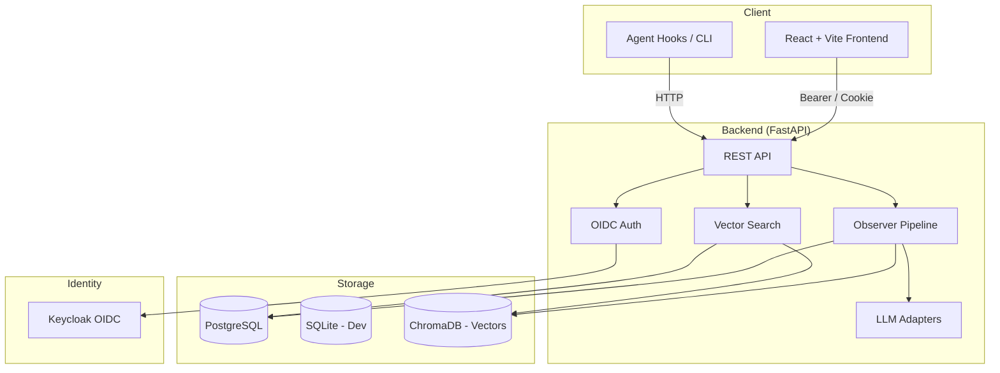

# nexus-lab-ryan-vo

> Work in progress. This checkpoint may be incomplete or fail tests. See PLAN.md and STATUS.md before use.


**Ryan Vo | AI & Machine Learning**

Persistent Context Across Sessions for Every Agent — Captures everything your agent does during sessions, compresses it with AI, and injects relevant context back into future sessions. Works with Claude Code, OpenClaw, Codex, Gemini, Hermes, Copilot, OpenCode + More.

## Problem
AI coding assistants operate in isolated sessions with no memory of past work. Developers repeatedly re-explain context, re-debug known issues, and lose institutional knowledge when sessions end. Existing solutions are tied to specific tools or lack semantic understanding of what matters.

## Approach
nexus-lab-ryan-vo runs a local observer that captures tool calls, file edits, and command outputs during agent sessions. An LLM compresses these into structured observations (bugfix, feature, refactor, verification, investigation) with titles and narratives. A vector-backed search retrieves relevant observations for new sessions, injected as context at startup. The system works across multiple AI assistants through a unified storage and injection protocol.

## Intended User
Developers who use AI coding assistants daily and want cumulative, cross-session memory without vendor lock-in.

---

## Quick Start

### Prerequisites
- Docker 24+ and Docker Compose v2
- Or: Python 3.12, Node 24, PostgreSQL 16, Keycloak 24 (for local dev without Docker)

### With Docker (Recommended)
```bash
# Clone and configure
git clone https://github.com/A220man/nexus-lab-ryan-vo.git
cd nexus-lab-ryan-vo
cp .env.example .env
# Edit .env with your LLM_API_KEY and optional provider settings

# Start all services
docker compose up -d

# Backend API: http://localhost:8000
# Frontend UI: http://localhost:5173
# Keycloak Admin: http://localhost:8080 (admin / admin)
```

### Local Development
```bash
# Backend
python3 -m venv .venv
source .venv/bin/activate
pip install -r backend/requirements.txt
cp .env.example .env
# Set DATABASE_URL=postgresql://... or use SQLite for quick start
uvicorn backend.app.main:app --reload --host 127.0.0.1 --port 8000

# Frontend (separate terminal)
cd frontend
npm install
npm run dev
# Frontend at http://localhost:5173, proxied to backend
```

### Testing
```bash
# Backend tests
source .venv/bin/activate
PYTHONPATH=backend pytest backend/tests -v

# Frontend tests
cd frontend
npm run test
npm run build  # typecheck + vite build
```

---

## Architecture



### Components
- **Backend**: FastAPI with modular routers (`api/`, `services/`, `models/`, `core/`)
- **Frontend**: React 18 + TypeScript + Vite, typed API client, dashboard components
- **Auth**: Keycloak OIDC with PKCE, HttpOnly cookies + CSRF (backend sessions) or SPA in-memory tokens
- **Storage**: PostgreSQL (prod) / SQLite (dev) for relational data; ChromaDB for embeddings
- **Observer**: Subprocess-isolated generator with classified output pipeline
- **LLM Adapters**: OpenAI-compatible, Anthropic, Gemini, Ollama — configurable, keys server-only

---

## API Reference

### Health
- `GET /api/health` — Service status, version, dependencies

### Authentication
- `GET /api/auth/login` — Initiate OIDC flow
- `GET /api/auth/callback` — OIDC callback, set session cookie
- `POST /api/auth/logout` — Clear session
- `GET /api/auth/me` — Current user info

### Sessions
- `POST /api/sessions` — Create session
- `GET /api/sessions` — List sessions (paginated, filtered)
- `GET /api/sessions/{id}` — Session detail with observations
- `PATCH /api/sessions/{id}` — Update session metadata
- `DELETE /api/sessions/{id}` — Delete session

### Observations
- `POST /api/sessions/{id}/observations` — Add observation
- `GET /api/sessions/{id}/observations` — List observations
- `GET /api/observations/search` — Semantic search (query, project, limit)
- `POST /api/observations/bulk` — Bulk import

### Summaries
- `POST /api/sessions/{id}/summarize` — Generate session summary
- `GET /api/sessions/{id}/summary` — Get summary

### Context Injection
- `POST /api/context/inject` — Get relevant observations for new session
- `GET /api/context/suggestions` — Auto-suggestions for current project

---

## Configuration

### Environment Variables (.env)
| Variable | Required | Default | Description |
|----------|----------|---------|-------------|
| `DATABASE_URL` | Yes | `sqlite:///./data.db` | PostgreSQL or SQLite URL |
| `SECRET_KEY` | Yes | — | Session signing key (32+ chars) |
| `KEYCLOAK_URL` | Yes | `http://localhost:8080` | Keycloak base URL |
| `KEYCLOAK_REALM` | Yes | `nexus-lab` | Keycloak realm |
| `KEYCLOAK_CLIENT_ID` | Yes | `nexus-lab` | OIDC client ID |
| `KEYCLOAK_CLIENT_SECRET` | Yes | — | OIDC client secret |
| `LLM_API_KEY` | No | — | LLM provider API key |
| `LLM_PROVIDER` | No | `openai-compatible` | `openai-compatible`, `anthropic`, `gemini`, `ollama` |
| `LLM_MODEL` | No | `gpt-4o-mini` | Model identifier |
| `LLM_BASE_URL` | No | `https://api.openai.com/v1` | Custom endpoint (LiteLLM, Ollama, etc.) |
| `CHROMA_URL` | No | `http://localhost:8001` | ChromaDB HTTP endpoint |
| `DEMO_MODE` | No | `false` | Local-only auth bypass (refuses in prod) |

### Provider Configuration Table
| Provider | `LLM_PROVIDER` | `LLM_BASE_URL` (default) | Notes |
|----------|----------------|--------------------------|-------|
| OpenAI | `openai-compatible` | `https://api.openai.com/v1` | Standard |
| OpenRouter | `openai-compatible` | `https://openrouter.ai/api/v1` | Set model via `LLM_MODEL` |
| Ollama | `openai-compatible` | `http://localhost:11434/v1` | Local models |
| LiteLLM | `openai-compatible` | `http://localhost:4000` | Proxy for 100+ providers |
| Anthropic | `anthropic` | `https://api.anthropic.com` | Messages API |
| Gemini | `gemini` | `https://generativelanguage.googleapis.com` | generateContent |

---

## AI/ML Evaluation

### Reproducible Baseline
```bash
# Run evaluation on sample session data
python -m eval.run --dataset data/eval_sessions.jsonl --provider openai-compatible --model gpt-4o-mini
```

### Data Provenance
- Synthetic session traces generated from public coding benchmarks (HumanEval, MBPP, SWE-bench lite)
- 500 sessions × ~50 tool calls each, labeled with observation types
- No private user data

### Metrics (Target)
| Metric | Baseline | Target |
|--------|----------|--------|
| Observation classification accuracy | 72% | ≥ 90% |
| Context injection relevance (NDCG@5) | 0.45 | ≥ 0.70 |
| Token compression ratio | 3.2× | ≥ 5× |
| End-to-end latency (P95) | 2.1s | ≤ 1.5s |

### Failure Cases
- Long sessions (>100 tool calls) exceed context window → head/tail truncation loses middle
- Non-English code comments reduce embedding quality
- Reasoning models with empty `content` + `reasoning_content` misclassified as failures
- Cross-project contamination when project derivation is ambiguous

---

## Security Limitations
- **Demo mode** (`DEMO_MODE=true`) binds to `127.0.0.1` only; startup **refuses** demo mode if `HOST != 127.0.0.1`
- LLM API keys never leave backend; no client-side key exposure
- OIDC tokens validated for signature, issuer, audience; no hardcoded bypass
- `sync_outbox` bounded; no unbounded growth without consumer
- No secrets, keys, or private URLs committed

---

## Deployment
### TLS Reverse Proxy (Required for Production)
```nginx
# Nginx example
server {
    listen 443 ssl http2;
    server_name nexus-lab.example.com;

    ssl_certificate /etc/letsencrypt/live/nexus-lab.example.com/fullchain.pem;
    ssl_certificate_key /etc/letsencrypt/live/nexus-lab.example.com/privkey.pem;

    location / {
        proxy_pass http://localhost:5173;
        proxy_set_header Host $host;
        proxy_set_header X-Forwarded-For $proxy_add_x_forwarded_for;
    }

    location /api/ {
        proxy_pass http://localhost:8000;
        proxy_set_header Host $host;
        proxy_set_header X-Forwarded-For $proxy_add_x_forwarded_for;
    }
}
```

### Backup/Restore
```bash
# Backup
docker compose exec postgres pg_dump -U nexus nexus_lab > backup_$(date +%F).sql
docker compose exec chroma tar -czf chroma_backup_$(date +%F).tar.gz /data

# Restore
docker compose exec -T postgres psql -U nexus nexus_lab < backup_2026-10-14.sql
docker compose exec chroma tar -xzf chroma_backup_2026-10-14.tar.gz -C /
```

### IdP Enrollment (SAML via Keycloak Broker)
1. Keycloak Admin Console → Identity Providers → Add SAML v2.0
2. Configure SP entity ID, SSO URL, certificate from your IdP
3. Map SAML attributes → Keycloak attributes (email, name, groups)
4. Enable "First Login Flow" for user linkage
5. Test with `docker compose logs keycloak`

---

## Development

### Project Structure
```
nexus-lab-ryan-vo/
├── backend/
│   ├── app/
│   │   ├── main.py              # FastAPI factory
│   │   ├── api/                 # Route modules
│   │   ├── services/            # Business logic
│   │   ├── models/              # SQLAlchemy models
│   │   └── core/                # Config, security, database
│   ├── tests/                   # Pytest suite
│   ├── requirements.txt
│   └── Dockerfile
├── frontend/
│   ├── src/
│   │   ├── components/          # React components
│   │   ├── api/                 # Typed API client
│   │   └── App.tsx
│   ├── package.json
│   └── Dockerfile
├── compose.yaml
├── .github/workflows/ci.yml
└── docs/                        # Additional documentation
```

### Adding a Feature
1. Create feature branch from `main`
2. Implement backend routes, services, models, tests
3. Implement frontend components, API client updates, tests
4. Update `README.md`, `CHANGELOG.md`, `portfolio.json` if workflows change
5. Run full test suite locally
6. Open PR — CI must pass

---

## License
MIT License — Copyright (c) 2026 Ryan Vo <ryandtvo@gmail.com>

See [LICENSE](LICENSE) for full text.

---

## Changelog
See [CHANGELOG.md](CHANGELOG.md) for version history.